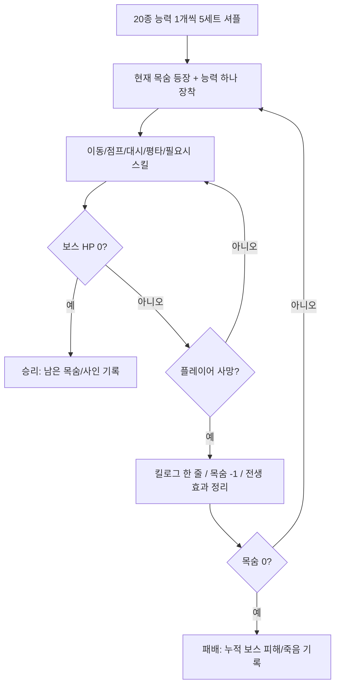

# GAME DESIGN — 100 LIVES VS 1 BOSS

## 0. 문서 목적

이 문서는 **컨텍스트 압축이나 개발 세션 교체 후에도 유지할 게임의 설계 기준**이다. 단순 아이디어 목록이 아니라 구현·플레이 테스트·범위 변경 시 판단 기준으로 사용한다. 아래 '불변'을 변경하려면 별도의 기획 결정이 필요하다.

## 1. 게임 정체성

- **장르:** 2D 사이드뷰 플랫포머 액션 / 단일 보스전 / B급 물리 코미디
- **게임 잼 주제:** Inconvenient Superpowers (불편한 초능력)
- **한 줄 기획:** *초월적으로 강하지만 주인까지 죽이기 쉬운 능력을 가진 100명의 용사가, 체력이 더럽게 많은 보스 하나를 쓰러뜨린다.*
- **콘셉트:** 평범하고 읽기 쉬운 보스 vs. 능력이 비정상적으로 강한 대신 위험한 플레이어
- **시청각 방향:** 단순 프리미티브·막그림·어색한 이름·과장된 넉백/사망 자막. 저예산의 외형은 허용, 입력/피격/가독성 품질 저하는 불허.

### 핵심 플레이 경험

1. **쾌감:** 말도 안 되는 위력의 한 방이 보스에게 먹힌다.
2. **황당함:** 같은 한 방이 자신까지 날려 죽인다.
3. **학습:** 다음번에는 결함을 고려해 각도·거리·타이밍을 고친다.
4. **집요함:** 보스 HP가 누적 감소하므로 실패해도 전투의 진척이 남는다.

### 불변 규칙

- 플레이어에게 매 목숨마다 **정확히 하나의 초능력** 부여.
- `active`는 K 스킬 제공 여부다. 하나의 능력 런타임이 이동·평타·가드 변경과 선택적인 K 스킬 하나를 함께 가질 수 있다(A12). 기본 행동 연동만 있는 능력은 K를 쓰지 않는다.
- 기본 이동·점프·대시·평타는 초능력이 없어도 동작하며, **보스의 모든 기본 패턴을 기본 조작으로 대응 가능**해야 한다.
- 기본 플레이어 HP 1. A12는 명시적인 예외로 높은 체력을 가진다. 일반 피해는 HP 차감, 낙사·치명 충돌·확정 자폭은 체력과 무관한 사망이다. 비치명 피해는 생명을 소모하지 않는다.
- 총 100목숨 = 능력 20종 × 종당 5개. 한 세트 20종을 셔플하고 이 세트를 5회 연결.
- 보스 HP·페이즈는 플레이어 사망 후 유지. 보스는 큰 HP와 전형적인 보스 패턴 중심.
- 사망 시 우상단 킬로그가 하찮게 한 줄 추가되며 즉시 다음 생명으로 이어진다.
- **쿨다운/체력 소모만으로 '불편함'을 구현하지 않는다.** 효과의 공간·운동·충돌·제어·시간적 결함이어야 한다.
- 플레이어의 선택과 숙련을 무력화하는 랜덤 즉사, 불가피한 피격 연계 금지.

## 2. 기본 전투 루프



- **남은 목숨 표기:** 첫 등장 시 `100/100`. 살아 있는 현재 생명도 남은 목숨에 포함. 최초 사망 이후 `99/100`.
- **동시 죽음:** 같은 피해 해결 단계에서 보스와 마지막 플레이어가 함께 죽으면 **보스 처치 승리 우선**.
- **능력 교체:** 사망 시 자동. 전투 중 수동 교체 불가.
- **부활:** 사망 연출/킬로그 후 가능한 0.5~1.0초 내 복귀. 부활 직후 안전 판정 제공, 보스의 진행 중 공격은 일시 정리. 보스 HP/페이즈는 건드리지 않음.
- **사망 이전에 만든 피해:** 적용된 피해는 유지. 전생에 남겨 놓은 지속 판정·예약 공격은 정리(P0 규칙).
- **콘텐츠 반복:** 실제 구현은 능력 20종이며 동일 능력은 플레이 전체에서 최대 5번 등장. 첫 세트에서는 전 능력을 경험할 기회 제공.

## 3. 기본 입력 사양

| 입력 | 기본 동작 | 능력이 개입할 수 있는 부분 |
|---|---|---|
| A / D | 좌우 이동 | 이동 속도·마찰·넉백, 방향 |
| 마우스 위치 | 플레이어 기준 360도 조준·좌우 시선 | 방향 공격·대시·방향 능력 |
| S | 숙이기 또는 빠른 낙하, 낮은 발판 통과 | 강하 속도, 충돌 형태 |
| Space | 점프 | 점프 가속도·착지 이벤트·공중 동작 |
| Shift | 입력 순간 마우스 방향으로 대시 | 대시 속도·지속시간·충돌·제어 가능 여부 |
| J 또는 마우스 좌클릭 | 입력 순간 마우스 방향으로 평타 | 피해, 타격 범위·잔류 효과·자기 반동 |
| Q 유지 | 현재 마우스 방향 전방 가드 | 경량 물리 방어, 가짜 가드·반격·마법 가드·취약성 |
| K 또는 마우스 우클릭 | **액티브 능력에 한해** 스킬, 방향은 입력 순간 고정 | 발동·설치·광선·변신 등 |

> W/S는 조준에 관여하지 않는다. S는 기존 공중 강하를 유지한다. 마우스가 플레이어와 거의 겹치거나 유효한 포인터 입력이 없으면 마지막 조준을 유지한다. A09의 보스 자동 조준, A07의 발사 후 보스 유도, A04 실제 바닥/발판·A06 고정 전방 충전, A08 이륙 위치, A16 자기 중심 폭발, A19의 K 중량화 착지 파동을 사용한다. `Passive` 장착 시 능력 버튼을 숨기거나 비활성화한다.

마우스 조준과 가드/능력 개정은 `ba7b72a` 위의 미플레이 변경이다. 이번 확정 개정은 아래 표에 반영했으며 실제 플레이 평가는 사용자가 진행한다. Q는 유지 방어이며 패리 시스템은 추후 확장이다. 기본 가드는 전방 경량 물리만, A11은 전방 마법만 방어하고 중량 공격·자기 효과·환경 충돌은 방어하지 않는다.

**공통 액션 요구사항:** 점프 버퍼, 코요테 타임 등은 템플릿에 이미 있으면 재사용하고, POC 조작이 불쾌하지 않은 최소 범위에서만 보완. 주기적 자해 판정 때문에 입력지연/물리 끊김이 발생해서는 안 됨.

## 4. 능력 디자인 원칙

능력마다 다음 요소를 정의한다.

- **초월적 효과:** 다른 게임의 일반적인 기본 스킬보다 과장되게 강한 효과.
- **불편한 결함:** 사용자 안전·입력 제어·타이밍·환경과의 충돌 문제.
- **역이용 가능한 상황:** 보스의 위치·패턴·맵 지형을 이용해 결함을 우회하거나 공격으로 바꿀 수 있어야 함.
- **사망 원인:** 같은 물리 규칙에 따라 자신이 당하면 킬로그에 정확한 원인 표시.
- **입력 경로:** 기본 동작/가드 변경과 선택적인 K 스킬 하나를 같은 능력에 병용할 수 있다. 별도 모드·추가 키는 만들지 않는다.

**원작과의 관계:** 아래 이름은 내부 작업용 가칭이다. 이전 기획 대화에서 가져온 이름과 신규 각색을 혼합했으며, 원작 정합성과 이용 권한을 보장하지 않는다. 독자 게임 공개 전 명칭·디자인 변경을 전제한다.

## 5. POC 능력 20종 — 확정 구현 후보

각 능력은 런마다 **5장씩**, 총 100장으로 덱을 만든다. `P`=기본 행동 연동 패시브(스킬 없음), `A`=별도 발동 액티브.

| ID | 가칭/계열 | 유형/기본 행동 | 강력한 효과 | 치명적 불편함 | 우회·역이용 포인트 |
|---|---|---|---|---|---|
| A01 | 핏빛 거미 | P · 평타 | 검을 실제로 휘두르며 칼끝 궤적 16구간을 월드에 4초 보존. 동일 스윙은 대상별 한 번 피해, 잔류 궤적은 소유자도 피해 | 공간·운동·피격 위험은 실제 판정으로 적용 | 조준·위치·타이밍으로 대응 |
| A02 | 티알파의 날개 | P · 대시 | 고속 고정 조준 대시. 충돌 법선 접근 속도로 벽·바닥·천장 위험 구분, 바닥 접선 이동은 충돌사 제외 | 공간·운동·피격 위험은 실제 판정으로 적용 | 조준·위치·타이밍으로 대응 |
| A03 | 백염의 병 | K | 몸에서 시작하는 고정 방향 광선이 몸 위치를 추종 | 발동 지점 위험 지역 없음. 별도 리스크는 재검토 | 마우스 방향 조준 |
| A04 | 강철의 숲 | 지상 K | 실제 바닥·발판 윗면에 자기 위치 포함 13개 고위력 칼날. 공중 발동 거부, 빠른 연속 발동 | 공간·운동·피격 위험은 실제 판정으로 적용 | 조준·위치·타이밍으로 대응 |
| A05 | 공명의 천둥북 | P · Q | 일반 전방 물리 방어 성공 시 충격파와 역반동. 패리·별도 K 방어 없음 | 공간·운동·피격 위험은 실제 판정으로 적용 | 조준·위치·타이밍으로 대응 |
| A06 | 뿌리의 지팡이 | K | 4초 제자리 충전 후 시전 시 고정한 전방에 12 피해. 대시·관성 제거, 충전 중 피격 가능 | 공간·운동·피격 위험은 실제 판정으로 적용 | 조준·위치·타이밍으로 대응 |
| A07 | 대지의 별 | K | 조준 발사 후 보스 유도. 소유자/회전 투사체 투영 반경으로 발사점 분리, 슬롯 내부 이동·연속 판정. 실제 자기 교차는 유지 | 공간·운동·피격 위험은 실제 판정으로 적용 | 조준·위치·타이밍으로 대응 |
| A08 | 만뢰의 창 | P · 점프 | 이륙점 지연 낙뢰 기존 구현·수치 유지. 사용자 플레이 미확인 | 공간·운동·피격 위험은 실제 판정으로 적용 | 조준·위치·타이밍으로 대응 |
| A09 | 갈래나무 창 | P · 평타/Q | 긴 자동 조준 평타. Q 방패는 보이지만 방어 실패. boss.Attacking 자동 취소 제거 | 공간·운동·피격 위험은 실제 판정으로 적용 | 조준·위치·타이밍으로 대응 |
| A10 | 나마흐의 눈물 | P · 평타/Q | 평타를 액체 투사체로 교체. Q 시작 시 남은 액체가 현재 소유자 위치로 돌아오며 실제 접촉 피해. 액체 없는 Q는 자해 없음 | 공간·운동·피격 위험은 실제 판정으로 적용 | 조준·위치·타이밍으로 대응 |
| A11 | 신뢰의 방벽 | P · 평타/Q | 약한 평타와 전방 마법 전용 Q 방어. 물리 방어 없음, 마법 패리는 추후 확장 | 공간·운동·피격 위험은 실제 판정으로 적용 | 조준·위치·타이밍으로 대응 |
| A12 | 태양의 서자 | 평타 + K + Q | 체력 6·강한 평타·단일 충전 찌르기. 생명 중 Q 사용 후 다음 실제 미방어 피해는 체력과 무관하게 사망, HUD 표시 | 공간·운동·피격 위험은 실제 판정으로 적용 | 조준·위치·타이밍으로 대응 |
| A13 | 초근력 | P · 평타 | 360도 역반동 유지. 실제 누적 이동거리·공중 최고점부터 낙하량·착지 속도 위험. 재공격으로 공중 기록 초기화하지 않음 | 공간·운동·피격 위험은 실제 판정으로 적용 | 조준·위치·타이밍으로 대응 |
| A14 | 거대화 | K + 평타 | 3배 거대화와 강화·확대 평타. 체력은 기본 1, 시각과 콜라이더 동일 배율, 지상 변신/해제는 발바닥 유지 | 공간·운동·피격 위험은 실제 판정으로 적용 | 조준·위치·타이밍으로 대응 |
| A15 | 맹독 숨결 | K | 맹독 숨결. 강한 방향 분사 중 이동·조준 고정, 시전 자리에 지연 독. 분사 1.1초 후 독 활성 1.6초까지 이탈 여유 | 공간·운동·피격 위험은 실제 판정으로 적용 | 조준·위치·타이밍으로 대응 |
| A16 | 인간 폭탄 | K | 기존 자폭 유지. 보스 피해 뒤 소유자 확정 사망은 높은 체력에서도 보장 | 공간·운동·피격 위험은 실제 판정으로 적용 | 조준·위치·타이밍으로 대응 |
| A17 | 살인 고함 | K | 기존 방향 음파·보스 밀침 유지, 자기 기절 3초와 대시·관성 중단 | 공간·운동·피격 위험은 실제 판정으로 적용 | 조준·위치·타이밍으로 대응 |
| A18 | 차원 충격파 | K | 현재 방향 충전 광선과 데이터 그대로 유지. 재설계 보류, 덱 포함 | 공간·운동·피격 위험은 실제 판정으로 적용 | 조준·위치·타이밍으로 대응 |
| A19 | 초중량화 | 어디서나 K | 지상·점프·대시 중 3초 중량화. 대시 중단, 공중이면 즉시 하강, 지상 점프 허용. 강화 중력·착지 파동, 발동 전 공중 최고점도 위험 계산에 포함 | 공간·운동·피격 위험은 실제 판정으로 적용 | 조준·위치·타이밍으로 대응 |
| A20 | 유체화 | P · 대시 | 유체 대시 중 하향 가속도 38. 지상에서도 침강, 종료 즉시 실제 중첩 검사, 안전 위치로 밀어내지 않음 | 공간·운동·피격 위험은 실제 판정으로 적용 | 조준·위치·타이밍으로 대응 |

### 능력별 검증 메모

- `A08`은 이전 구상 '소지만 하면 자동 낙뢰'를 **점프 연동 패시브**로 수정. 이유: 패시브는 반드시 기본 조작과 결합해야 한다는 상위 원칙.
- `A16` 자폭은 **일정량의 확정 피해를 얻는 대가로 목숨 1개**를 교환하는 예외. 최적 전략이 자폭만 반복하는 방향이 되지 않도록 5장 제한·조건부 최대 피해·다른 능력과 비교 테스트.
- `A11`은 물리 공격에 무력한 능력이지, 무조건 실패하는 능력이 아님. 보스 마력탄·레이저에서 실질적으로 유용해야 한다.
- `A05`는 방어가 발동해도 사용자 위험이 존재해야 한다. 단, 매번 무조건 사망하여 활용 여지가 사라지게 하지 않는다.
- `A19`는 지상·점프·대시 중 K로 중량화를 발동한다. S는 공통 공중 강하만 담당한다. 지상에서 중량화를 켜고 점프할 수 있으며, 발동 전 공중 최고점도 착지 위험에 포함한다.
- `A02/A20`의 위험 판정은 단순 키 눌림이 아니라 실제 이동·충돌 결과로 계산한다.
- 20종이 개별 클래스를 요구하지 않는다. 효과·요청 변형으로 재사용 가능한 경우 설정 기반 구현.

## 6. 보스 기획 — 마왕 김철수(가칭)

**보스 정체성:** 크고 느리며 예고가 뚜렷한 전형적 대검 마왕. 보스 자체의 복잡함보다 이상한 능력이 만들어내는 사건을 우선한다.

- 키: 플레이어의 약 3~4배, 큰 피격 박스
- HP: 초기 임시값 `1,200` (테스트에서 조정)
- 기본 패턴 5종, HP 50% 이하에서 추가 2종 및 일부 연계
- 보스는 체력이 높지만 특별한 약점/무구 전용 퍼즐/능력 상성 강제는 없음
- 모든 공격은 기본 점프·이동·대시로 회피 가능. 능력 효과 때문에 어려워지는 것이 핵심.
- **초기 패턴 수치는 튜닝 값이며 확정 밸런스가 아니다.**

### 7개 보스 패턴

| ID | 패턴 | 예고(초) | 공격 방식 | 회피 힌트 | 후딜(초) | 페이즈 |
|---|---|---:|---|---|---:|---|
| B01 | 대검 횡베기 | 0.60 | 전방 수평 근접 광범위 판정 | 점프/배후 이동 | 0.70 | 1·2 |
| B02 | 대검 내려찍기 | 0.80 | 사전 추적한 위치에 강한 낙하 타격 | 좌우 대시 | 1.20 | 1·2 |
| B03 | 벽까지 돌진 | 0.90 | 한쪽 방향 고속 이동 후 벽 충돌 | 점프/상단 발판 | 1.50 | 1·2 |
| B04 | 지면 충격파 | 0.70 | 양방향 지면을 따라 판정 진행 | 타이밍 점프 | 0.60 | 1·2 |
| B05 | 마력탄 3연사 | 0.60 | 플레이어를 향해 3발 연속 발사 | 탄도 관찰, 이동/대시 | 0.70 | 1·2 |
| B06 | 운석 낙하 | 0.90 | 바닥 경고 위치로 떨어지는 공격 | 표식 밖 이동 | 0.80 | 2 |
| B07 | 레이저 훑기 | 1.00 | 전방에서 상향으로 훑는 광선 | 사전 배후 진입 | 1.00 | 2 |

- **페이즈 1 (100~50%):** B01~B05, 길고 큰 후딜, 반복 판독하기 쉬운 동작.
- **페이즈 2 (50~0%):** B06·B07 추가, 일부 B01→B02, B02→B04, B05→B03 연계. 무조건 피할 수 없는 조합은 금지.
- **보스 사망 처리:** 남은 이펙트·패턴 정리 후 승리. 목숨이 0인 순간과 동시이면 승리 우선.
- **재등장 안전:** 플레이어 죽음 시 현재 보스 공격/투사체 정리, 플레이어 재등장 중 짧게 정지. HP·페이즈·누적 피해는 그대로.

### 아레나

단일 가로형 전투 공간, 낮은 점프 발판 두 개, 작은 낙사 위험 구간, 시각적으로 분명한 좌우 경계. 실제 물리/절단 지형 생성 금지. `A02`의 벽 충돌, `A19`의 낙하, `A20`의 땅 관통 위험 등 시험 가능해야 함. 능력에 의해 아레나가 영구 변경되지 않음.

## 7. HUD·연출

### 상단 HUD

- 보스 이름/HP 바(화면 상단, 크게)
- 남은 목숨 `100/100`(명확하게)
- 현재 능력명/짧은 결함 설명 (예: `티알파의 날개 — 감속 기능 없음`)
- K를 제공할 때 `K 스킬` 안내를 표시한다. A12처럼 평타·가드 변화와 함께 안내할 수 있다. HP와 Q 사용 후 취약성을 HUD에 표시한다.

### 킬로그 (우측 상단)

- 사망 시 화면을 멈추지 않고 **최대 5줄**이 배그 킬피드처럼 쌓임.
- 형식: `가해 원인  [작은 아이콘]  희생자` (예: `본인의 주먹 ☠ 용사 #24`).
- 보스 공격/환경/본인 무구/자폭/낙사 등 `DeathCause`에 따라 문구가 달라짐.
- 짧은 페이드 아웃, 새 로그가 이전 로그를 밀어냄.
- 사망 원인 가독성이 농담보다 우선. 사실과 다른 사인 금지.
- 영구 묘비 UI, 긴 게임오버 연출, 매번 뜨는 튜토리얼은 제외.

### 예시 킬로그

```text
벽                 ☠  용사 #002
핏빛 거미          ☠  용사 #003
마왕 김철수        ☠  용사 #004
본인의 근육        ☠  용사 #005
바닥               ☠  용사 #006
```

### 짜치는 시각 스타일

막그림/단순 스프라이트, 과장된 넉백·찢어지는 것 같은 일회성 사망 효과, 촌스러운 전설 설명, 짧은 사운드. **저퀄리티 연출은 의도적이어도 피격 가독성과 게임 반응성은 정교하게 유지.** Ragdoll/Rigidbody 대량 생성 금지. POC에서는 단순 사망 연출/시체 스프라이트로 충분.

## 8. 초기 밸런스 가정(확정값 아님)

| 항목 | 초기값/목표 | 의미 |
|---|---|---|
| 보스 HP | 1,200 | 큰 체력 느낌. 플레이 테스트 후 조정 |
| 기본 평타 피해 | 8 | 무구 없이도 적은 피해 가능 |
| 강력한 능력 적중 피해 | 대략 30~100 | 능력을 쓰면 큰 체감 타격 |
| 자폭 최대 피해 | 150 | 큰 피해지만 생명 1개 확정 소모 |
| 사망→다음 조작 | 0.5~1.0초 목표 | 리듬 유지 |
| 첫 완주 소요 | 대략 5~8분 목표 | 클리어가 지나치게 길면 조정 |
| 숙련자 소모 목숨 | 대략 20~35개 가설 | '100개 모두 쓰기'는 강제하지 않음 |
| 초보자 소모 목숨 | 대략 50~80개 가설 | 좌절 없이 보스 HP 누적 감소 |

## 9. POC 범위

### 필수 (P0: 게임 잼 목표 완료 상태)

- **단일 플레이어** 2D 이동/점프/대시/평타/필요시 스킬; 충돌·자해 규칙
- **20종 능력 전부 동작**하며 패시브/액티브 구분이 정확함
- **20×5 셔플 5세트**로 정확히 100번 등장 기회, 죽을 때만 능력 교체
- **1명의 보스, 7개 패턴, 2개 페이즈**, 높은 HP와 HP 영속
- **우상단 사망 킬로그**, 목숨 및 능력 HUD, 승패 결과
- 죽음/부활 100회 루프에서 상태 누수 없음; 즉시 재시도 가능
- POC 플레이 테스트 로그 및 스모크 테스트

### 구현 순서의 중간 이정표 (최종 범위 축소가 아님)

1. 기본 액션 + 1HP + 단일 보스 3패턴 + 목숨/킬로그
2. 대표 능력 5종 (`A01/A02/A05/A13/A16`)으로 패시브/액티브, 자해, 반격 검증
3. 보스 7패턴/2페이즈 완료
4. 능력 총 20종 완성 + 5세트 덱
5. 게임 잼용 연출, 밸런스, 테스트

### 제외 (P1 이후)

- 보스 2명 이상, 스테이지 탐험, 방대한 장비 수집/제작, 랜덤 스탯 성장
- 108종 실제 구현, RPG 스킬 트리, 적 잡몹 군단, 온라인/멀티플레이
- 복잡한 물리 절단·완전 래그돌·무구 간 동시 장착·대규모 애니메이션 제작
- 원작 고유 외형 재현, 음악/고가 유료 에셋 전제

## 10. 실패를 감지하는 기획 테스트

- 능력을 **사용하지 않는 편이 계속 낫다** → 능력 위력·활용 기회·설명 조정.
- 보스에게 맞아 죽는 비율만 높고 자해는 드물다 → 불편함 규칙이 전투와 상호작용하지 않는 것.
- 죽자마자 일부러 자살해 다음 능력을 기다린다 → 능력 간 극단적인 효율 차이·셔플 정책 문제.
- 특정 무구가 없으면 특정 보스 패턴이 회피 불가능하다 → 설계 위반.
- 자폭만 쓰는 편이 가장 빠르다 → 자폭의 확정 피해·접근 조건 튜닝.
- 사망이 연속 발생하는데 원인이 불명확하다 → 킬로그·시각 경고·안전 부활 개선.
- 처음 5개 능력만 재미있고 나머지 15개는 숫자만 다르다 → 무구별 공간/조작 다이내믹 구분 재검토.

## 11. 변경 기록

- v0.1: 20개 능력 및 5×20 목숨 정책, 7패턴 보스, 킬로그, 1HP, 능력 1슬롯, 패시브 기본 행동 연동 규칙 확정.
- v0.1: `A08 만뢰의 창`을 소지형 자동 발동에서 **점프 연동 패시브**로 변경.
- v0.1: 스킬과 동시에 죽는 자폭/보스 동시 사망 우선순위 명시.
