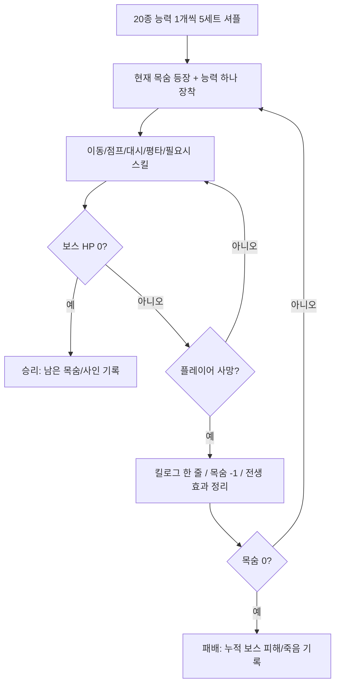

# GAME DESIGN — 100 LIVES VS 1 BOSS

## 0. 문서 목적

이 문서는 **컨텍스트 압축이나 개발 세션 교체 후에도 유지할 게임의 설계 기준**이다. 단순 아이디어 목록이 아니라 구현·플레이 테스트·범위 변경 시 판단 기준으로 사용한다. 아래 '불변'을 변경하려면 별도의 기획 결정이 필요하다.

## 1. 게임 정체성

- **장르:** 2D 사이드뷰 플랫포머 액션 / 단일 보스전 / B급 물리 코미디
- **게임 잼 주제:** Inconvenient Superpowers (불편한 초능력)
- **한 줄 기획:** *초월적으로 강하지만 주인까지 죽이기 쉬운 능력을 가진 100명의 용사가, 체력이 더럽게 많은 보스 하나를 쓰러뜨린다.*
- **콘셉트:** 평범하고 읽기 쉬운 보스 vs. 능력이 비정상적으로 강한 대신 위험한 플레이어
- **시청각 방향:** 단순 프리미티브·막그림·어색한 이름·과장된 넉백/사망 자막. 저예산의 외형은 허용, 입력/피격/가독성 품질 저하는 불허.

### 핵심 플레이 경험

1. **쾌감:** 말도 안 되는 위력의 한 방이 보스에게 먹힌다.
2. **황당함:** 같은 한 방이 자신까지 날려 죽인다.
3. **학습:** 다음번에는 결함을 고려해 각도·거리·타이밍을 고친다.
4. **집요함:** 보스 HP가 누적 감소하므로 실패해도 전투의 진척이 남는다.

### 불변 규칙

- 플레이어에게 매 목숨마다 **정확히 하나의 초능력** 부여.
- 초능력은 `Passive` 또는 `Active`로 구분. `Passive`는 **W/A/S/D·점프·대시·평타 중 기존 동작과 연결될 때만 허용**, 별도 스킬 입력 없음. `Active`만 스킬 입력 사용.
- 기본 이동·점프·대시·평타는 초능력이 없어도 동작하며, **보스의 모든 기본 패턴을 기본 조작으로 대응 가능**해야 한다.
- 플레이어 HP 1. 피격/낙사/자해 시 사망. 사망은 빈번하지만 짧게 처리한다.
- 총 100목숨 = 능력 20종 × 종당 5개. 한 세트 20종을 셔플하고 이 세트를 5회 연결.
- 보스 HP·페이즈는 플레이어 사망 후 유지. 보스는 큰 HP와 전형적인 보스 패턴 중심.
- 사망 시 우상단 킬로그가 하찮게 한 줄 추가되며 즉시 다음 생명으로 이어진다.
- **쿨다운/체력 소모만으로 '불편함'을 구현하지 않는다.** 효과의 공간·운동·충돌·제어·시간적 결함이어야 한다.
- 플레이어의 선택과 숙련을 무력화하는 랜덤 즉사, 불가피한 피격 연계 금지.

## 2. 기본 전투 루프



- **남은 목숨 표기:** 첫 등장 시 `100/100`. 살아 있는 현재 생명도 남은 목숨에 포함. 최초 사망 이후 `99/100`.
- **동시 죽음:** 같은 피해 해결 단계에서 보스와 마지막 플레이어가 함께 죽으면 **보스 처치 승리 우선**.
- **능력 교체:** 사망 시 자동. 전투 중 수동 교체 불가.
- **부활:** 사망 연출/킬로그 후 가능한 0.5~1.0초 내 복귀. 부활 직후 안전 판정 제공, 보스의 진행 중 공격은 일시 정리. 보스 HP/페이즈는 건드리지 않음.
- **사망 이전에 만든 피해:** 적용된 피해는 유지. 전생에 남겨 놓은 지속 판정·예약 공격은 정리(P0 규칙).
- **콘텐츠 반복:** 실제 구현은 능력 20종이며 동일 능력은 플레이 전체에서 최대 5번 등장. 첫 세트에서는 전 능력을 경험할 기회 제공.

## 3. 기본 입력 사양

| 입력 | 기본 동작 | 능력이 개입할 수 있는 부분 |
|---|---|---|
| A / D | 좌우 이동 | 이동 속도·마찰·넉백, 방향 |
| W | 위 방향 입력/상향 조준 기준 | 타게팅 방향·특수 이동(능력이 요구하는 경우) |
| S | 숙이기 또는 빠른 낙하, 낮은 발판 통과 | 강하 속도, 충돌 형태 |
| Space | 점프 | 점프 가속도·착지 이벤트·공중 동작 |
| Shift | 대시 | 대시 속도·지속시간·충돌·제어 가능 여부 |
| J 또는 마우스 좌클릭 | 기본 평타 | 피해, 타격 범위·잔류 효과·자기 반동 |
| K 또는 마우스 우클릭 | **액티브 능력에 한해** 스킬 | 발동·설치·광선·변신 등 |

> W/S의 세부 값은 기존 템플릿 입력 구조에 맞춰 조정 가능. 단, 능력 구현을 위해 기본 조작 자체를 매번 새로 정의하지 않는다. `Passive` 장착 시 능력 버튼을 숨기거나 비활성화한다.

**공통 액션 요구사항:** 점프 버퍼, 코요테 타임 등은 템플릿에 이미 있으면 재사용하고, POC 조작이 불쾌하지 않은 최소 범위에서만 보완. 주기적 자해 판정 때문에 입력지연/물리 끊김이 발생해서는 안 됨.

## 4. 능력 디자인 원칙

능력마다 다음 요소를 정의한다.

- **초월적 효과:** 다른 게임의 일반적인 기본 스킬보다 과장되게 강한 효과.
- **불편한 결함:** 사용자 안전·입력 제어·타이밍·환경과의 충돌 문제.
- **역이용 가능한 상황:** 보스의 위치·패턴·맵 지형을 이용해 결함을 우회하거나 공격으로 바꿀 수 있어야 함.
- **사망 원인:** 같은 물리 규칙에 따라 자신이 당하면 킬로그에 정확한 원인 표시.
- **입력 경로:** 기본 동작 변경(Passive) 또는 K 발동(Active) **둘 중 하나**.

**원작과의 관계:** 아래 이름은 내부 작업용 가칭이다. 이전 기획 대화에서 가져온 이름과 신규 각색을 혼합했으며, 원작 정합성과 이용 권한을 보장하지 않는다. 독자 게임 공개 전 명칭·디자인 변경을 전제한다.

## 5. POC 능력 20종 — 확정 구현 후보

각 능력은 런마다 **5장씩**, 총 100장으로 덱을 만든다. `P`=기본 행동 연동 패시브(스킬 없음), `A`=별도 발동 액티브.

| ID | 가칭/계열 | 유형/기본 행동 | 강력한 효과 | 치명적 불편함 | 우회·역이용 포인트 |
|---|---|---|---|---|---|
| A01 | 핏빛 거미 / 무구 | P · 평타 | 평타 후 강력한 참격 궤적 4초 잔류 | 본인도 궤적에 닿으면 사망 | 보스 돌진 경로에 설치 후 다른 높이로 회피 |
| A02 | 티알파의 날개 / 무구 | P · 대시 | 긴 거리 초고속 대시 및 돌진 피해 | 대시 중 감속 불가, 벽 고속 충돌사 | 타이밍·방향·대시 거리 계산 |
| A03 | 백염의 병 / 무구 | A · K | 좁고 강한 직선 광선 | 발동 지점 근방에 위험 구역 생성 | 거리·방향·지형을 이용해 안전한 발사점 찾기 |
| A04 | 강철의 숲 / 무구 | A · K | 주변 바닥에서 연속 칼날 솟음 | 자신 근처에도 칼날 생성 | 발동 즉시 높은 발판으로 대피, 보스 유인 |
| A05 | 공명의 천둥북 / 무구 | A · K | 짧은 방어 자세에서 피격 시 강력한 충격파 | 방어 성공 시 자신도 반동/피해 위험 | 보스 몸통과 거리·공격 방향 계산 |
| A06 | 뿌리의 지팡이 / 무구 | A · K | 일정 시간 후 뿌리 범위 강타 | 발동이 매우 느림 | 미리 설치하고 보스를 공격 지점으로 유도 |
| A07 | 대지의 별 / 무구 | A · K | 보스 방향 관통 유도체 발사 | 궤도 안의 플레이어도 피격 | 궤도와 착탄 뒤 위치를 예측해 이동 |
| A08 | 만뢰의 창 / 무구 | **P · 점프** | 점프 후 일정 지연을 두고 강한 낙뢰 | 낙뢰가 이륙 지점/선정 지점에 떨어져 자신도 위험 | 점프 후 빠른 위치 이동, 보스를 낙뢰 지점으로 유인 |
| A09 | 갈래나무 창 / 무구 | P · 평타 | 평타 시 적 약점을 자동 추적 | 적의 반격이 감지되면 창이 제멋대로 회피해 공격이 빗나감 | 보스 후딜을 노리고 공격 |
| A10 | 나마흐의 눈물 / 무구 | P · 평타 | 평타 충돌 시 부식액 튐 | 근거리 분출 액체에 자신도 피격 | 거리·높이·타점 조절 |
| A11 | 신뢰의 방벽 / 무구 | A · K | 짧은 시간 원거리/마법 완전 방어 | 물리 대검·돌진에는 무력 | 보스 패턴을 정확히 구분해 발동 |
| A12 | 태양의 서자 / 무구 | P · 평타 | 강한 타격/긴 타격 범위 | 무기가 받은 강력한 충격이 사용자에게 전달 | 보스 후딜에만 안전 공격, 공격 방향 조절 |
| A13 | 초근력 / 아우터 | P · 평타 | 초고위력 평타 | 타격한 반대 방향으로 강한 자기 넉백 | 반동을 이동기로 활용, 벽·낙사 지점 주의 |
| A14 | 거대화 / 아우터 | A · K | 큰 히트박스, 긴 공격 범위·대미지 | 큰 피격 면적과 천장 충돌 | 넓은 바닥에서 변신, 좁은 지형 회피 |
| A15 | 산성 눈물 / 아우터 | A · K | 짧은 지속의 전방 산성 분사 | 근거리 충돌 시 산성 튐·자해 | 분사 각도·거리 확보 |
| A16 | 인간 폭탄 / 아우터 | A · K | 충전 후 대형 폭발, 고화력 | 발동과 함께 사용자 사망 확정 | 최대 피해를 줄 거리까지 접근해 생명 하나를 교환 |
| A17 | 살인 고함 / 아우터 | A · K | 전방 넓은 음파/넉백 | 발동 후 일정 시간 자기 기절 | 보스 후딜에서 발동하거나 밀쳐서 안전거리 확보 |
| A18 | 차원 충격파 / 아우터 | A · K | 관통 가능한 고화력 에너지파 | 충전 중 이동 불가 | 긴 보스 후딜에 차지 성공 |
| A19 | 초중량화 / 신규 각색 | P · S(공중) | 급강하 착지 시 거대한 충격파 | 높은 낙하/충돌은 본인에게도 치명적 | 낮은 점프·플랫폼 높이 계산 |
| A20 | 유체화 / 신규 각색 | P · 대시 | 대시 중 적 공격·장애물 통과 | 바닥/낙사 지형도 통과 | 대시 종료 위치를 안전 지형으로 맞춤 |

### 능력별 검증 메모

- `A08`은 이전 구상 '소지만 하면 자동 낙뢰'를 **점프 연동 패시브**로 수정. 이유: 패시브는 반드시 기본 조작과 결합해야 한다는 상위 원칙.
- `A16` 자폭은 **일정량의 확정 피해를 얻는 대가로 목숨 1개**를 교환하는 예외. 최적 전략이 자폭만 반복하는 방향이 되지 않도록 5장 제한·조건부 최대 피해·다른 능력과 비교 테스트.
- `A11`은 물리 공격에 무력한 능력이지, 무조건 실패하는 능력이 아님. 보스 마력탄·레이저에서 실질적으로 유용해야 한다.
- `A05`는 방어가 발동해도 사용자 위험이 존재해야 한다. 단, 매번 무조건 사망하여 활용 여지가 사라지게 하지 않는다.
- `A19`의 S는 공중일 때만 강하 입력으로 작동하여 기본 숙이기 동작과 충돌하지 않게 한다.
- `A02/A20`의 위험 판정은 단순 키 눌림이 아니라 실제 이동·충돌 결과로 계산한다.
- 20종이 개별 클래스를 요구하지 않는다. 효과·요청 변형으로 재사용 가능한 경우 설정 기반 구현.

## 6. 보스 기획 — 마왕 김철수(가칭)

**보스 정체성:** 크고 느리며 예고가 뚜렷한 전형적 대검 마왕. 보스 자체의 복잡함보다 이상한 능력이 만들어내는 사건을 우선한다.

- 키: 플레이어의 약 3~4배, 큰 피격 박스
- HP: 초기 임시값 `1,200` (테스트에서 조정)
- 기본 패턴 5종, HP 50% 이하에서 추가 2종 및 일부 연계
- 보스는 체력이 높지만 특별한 약점/무구 전용 퍼즐/능력 상성 강제는 없음
- 모든 공격은 기본 점프·이동·대시로 회피 가능. 능력 효과 때문에 어려워지는 것이 핵심.
- **초기 패턴 수치는 튜닝 값이며 확정 밸런스가 아니다.**

### 7개 보스 패턴

| ID | 패턴 | 예고(초) | 공격 방식 | 회피 힌트 | 후딜(초) | 페이즈 |
|---|---|---:|---|---|---:|---|
| B01 | 대검 횡베기 | 0.60 | 전방 수평 근접 광범위 판정 | 점프/배후 이동 | 0.70 | 1·2 |
| B02 | 대검 내려찍기 | 0.80 | 사전 추적한 위치에 강한 낙하 타격 | 좌우 대시 | 1.20 | 1·2 |
| B03 | 벽까지 돌진 | 0.90 | 한쪽 방향 고속 이동 후 벽 충돌 | 점프/상단 발판 | 1.50 | 1·2 |
| B04 | 지면 충격파 | 0.70 | 양방향 지면을 따라 판정 진행 | 타이밍 점프 | 0.60 | 1·2 |
| B05 | 마력탄 3연사 | 0.60 | 플레이어를 향해 3발 연속 발사 | 탄도 관찰, 이동/대시 | 0.70 | 1·2 |
| B06 | 운석 낙하 | 0.90 | 바닥 경고 위치로 떨어지는 공격 | 표식 밖 이동 | 0.80 | 2 |
| B07 | 레이저 훑기 | 1.00 | 전방에서 상향으로 훑는 광선 | 사전 배후 진입 | 1.00 | 2 |

- **페이즈 1 (100~50%):** B01~B05, 길고 큰 후딜, 반복 판독하기 쉬운 동작.
- **페이즈 2 (50~0%):** B06·B07 추가, 일부 B01→B02, B02→B04, B05→B03 연계. 무조건 피할 수 없는 조합은 금지.
- **보스 사망 처리:** 남은 이펙트·패턴 정리 후 승리. 목숨이 0인 순간과 동시이면 승리 우선.
- **재등장 안전:** 플레이어 죽음 시 현재 보스 공격/투사체 정리, 플레이어 재등장 중 짧게 정지. HP·페이즈·누적 피해는 그대로.

### 아레나

단일 가로형 전투 공간, 낮은 점프 발판 두 개, 작은 낙사 위험 구간, 시각적으로 분명한 좌우 경계. 실제 물리/절단 지형 생성 금지. `A02`의 벽 충돌, `A19`의 낙하, `A20`의 땅 관통 위험 등 시험 가능해야 함. 능력에 의해 아레나가 영구 변경되지 않음.

## 7. HUD·연출

### 상단 HUD

- 보스 이름/HP 바(화면 상단, 크게)
- 남은 목숨 `100/100`(명확하게)
- 현재 능력명/짧은 결함 설명 (예: `티알파의 날개 — 감속 기능 없음`)
- 액티브일 때만 `K 스킬` 안내. 패시브라면 `평타 변형` 등 기존 입력 안내.

### 킬로그 (우측 상단)

- 사망 시 화면을 멈추지 않고 **최대 5줄**이 배그 킬피드처럼 쌓임.
- 형식: `가해 원인  [작은 아이콘]  희생자` (예: `본인의 주먹 ☠ 용사 #24`).
- 보스 공격/환경/본인 무구/자폭/낙사 등 `DeathCause`에 따라 문구가 달라짐.
- 짧은 페이드 아웃, 새 로그가 이전 로그를 밀어냄.
- 사망 원인 가독성이 농담보다 우선. 사실과 다른 사인 금지.
- 영구 묘비 UI, 긴 게임오버 연출, 매번 뜨는 튜토리얼은 제외.

### 예시 킬로그

```text
벽                 ☠  용사 #002
핏빛 거미          ☠  용사 #003
마왕 김철수        ☠  용사 #004
본인의 근육        ☠  용사 #005
바닥               ☠  용사 #006
```

### 짜치는 시각 스타일

막그림/단순 스프라이트, 과장된 넉백·찢어지는 것 같은 일회성 사망 효과, 촌스러운 전설 설명, 짧은 사운드. **저퀄리티 연출은 의도적이어도 피격 가독성과 게임 반응성은 정교하게 유지.** Ragdoll/Rigidbody 대량 생성 금지. POC에서는 단순 사망 연출/시체 스프라이트로 충분.

## 8. 초기 밸런스 가정(확정값 아님)

| 항목 | 초기값/목표 | 의미 |
|---|---|---|
| 보스 HP | 1,200 | 큰 체력 느낌. 플레이 테스트 후 조정 |
| 기본 평타 피해 | 8 | 무구 없이도 적은 피해 가능 |
| 강력한 능력 적중 피해 | 대략 30~100 | 능력을 쓰면 큰 체감 타격 |
| 자폭 최대 피해 | 150 | 큰 피해지만 생명 1개 확정 소모 |
| 사망→다음 조작 | 0.5~1.0초 목표 | 리듬 유지 |
| 첫 완주 소요 | 대략 5~8분 목표 | 클리어가 지나치게 길면 조정 |
| 숙련자 소모 목숨 | 대략 20~35개 가설 | '100개 모두 쓰기'는 강제하지 않음 |
| 초보자 소모 목숨 | 대략 50~80개 가설 | 좌절 없이 보스 HP 누적 감소 |

## 9. POC 범위

### 필수 (P0: 게임 잼 목표 완료 상태)

- **단일 플레이어** 2D 이동/점프/대시/평타/필요시 스킬; 충돌·자해 규칙
- **20종 능력 전부 동작**하며 패시브/액티브 구분이 정확함
- **20×5 셔플 5세트**로 정확히 100번 등장 기회, 죽을 때만 능력 교체
- **1명의 보스, 7개 패턴, 2개 페이즈**, 높은 HP와 HP 영속
- **우상단 사망 킬로그**, 목숨 및 능력 HUD, 승패 결과
- 죽음/부활 100회 루프에서 상태 누수 없음; 즉시 재시도 가능
- POC 플레이 테스트 로그 및 스모크 테스트

### 구현 순서의 중간 이정표 (최종 범위 축소가 아님)

1. 기본 액션 + 1HP + 단일 보스 3패턴 + 목숨/킬로그
2. 대표 능력 5종 (`A01/A02/A05/A13/A16`)으로 패시브/액티브, 자해, 반격 검증
3. 보스 7패턴/2페이즈 완료
4. 능력 총 20종 완성 + 5세트 덱
5. 게임 잼용 연출, 밸런스, 테스트

### 제외 (P1 이후)

- 보스 2명 이상, 스테이지 탐험, 방대한 장비 수집/제작, 랜덤 스탯 성장
- 108종 실제 구현, RPG 스킬 트리, 적 잡몹 군단, 온라인/멀티플레이
- 복잡한 물리 절단·완전 래그돌·무구 간 동시 장착·대규모 애니메이션 제작
- 원작 고유 외형 재현, 음악/고가 유료 에셋 전제

## 10. 실패를 감지하는 기획 테스트

- 능력을 **사용하지 않는 편이 계속 낫다** → 능력 위력·활용 기회·설명 조정.
- 보스에게 맞아 죽는 비율만 높고 자해는 드물다 → 불편함 규칙이 전투와 상호작용하지 않는 것.
- 죽자마자 일부러 자살해 다음 능력을 기다린다 → 능력 간 극단적인 효율 차이·셔플 정책 문제.
- 특정 무구가 없으면 특정 보스 패턴이 회피 불가능하다 → 설계 위반.
- 자폭만 쓰는 편이 가장 빠르다 → 자폭의 확정 피해·접근 조건 튜닝.
- 사망이 연속 발생하는데 원인이 불명확하다 → 킬로그·시각 경고·안전 부활 개선.
- 처음 5개 능력만 재미있고 나머지 15개는 숫자만 다르다 → 무구별 공간/조작 다이내믹 구분 재검토.

## 11. 변경 기록

- v0.1: 20개 능력 및 5×20 목숨 정책, 7패턴 보스, 킬로그, 1HP, 능력 1슬롯, 패시브 기본 행동 연동 규칙 확정.
- v0.1: `A08 만뢰의 창`을 소지형 자동 발동에서 **점프 연동 패시브**로 변경.
- v0.1: 스킬과 동시에 죽는 자폭/보스 동시 사망 우선순위 명시.
