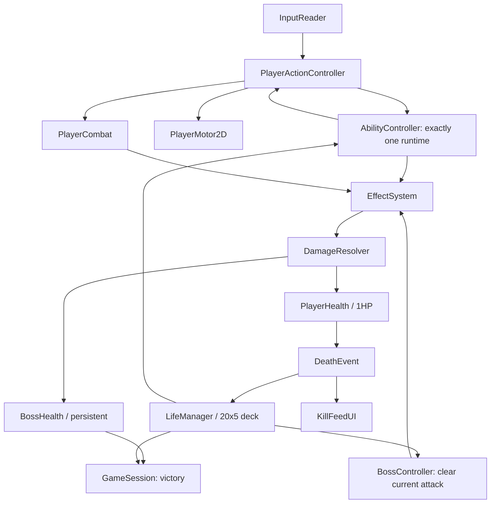

# TECHNICAL SPEC — Unity 7 POC 실행 구조

## 0. 기술 목표 및 범위

- 타깃: **기존 Unity 7 프로젝트/템플릿 기반**, 2D 사이드뷰, 싱글 플레이.
- 이 문서의 API 이름은 **계약을 위한 설계안**이며 현재 저장소의 실제 코드가 아니다. 작업 세션은 기존 네이밍/구조를 먼저 조사하고 재사용한다.
- **합격 상태:** 게임 오버/승리까지 플레이 가능, 20종 능력, 1보스 7패턴/2페이즈, 100목숨, 킬로그, 테스트·플레이 기록.
- Unity 7은 작성 시점 공식 **알파** 단계. 새 API에 의존하지 말고 현재 프로젝트에 설치된 `ProjectVersion.txt`, Input System, 2D Physics, 패키지 버전을 확인한 다음 컴파일/플레이 검증한다. 버전 교체·대규모 패키지 추가 금지.

## 1. 설계 의사결정

1. **플레이어 본체는 하나**를 재사용. 100명 오브젝트/프리팹 복제 금지.
2. **능력 1개 장착:** 매 생명마다 `AbilityDefinition` 1개 + 실행 상태 `AbilityRuntime` 1개.
3. 데이터는 ScriptableObject, 변하는 상태는 Runtime 객체/컴포넌트에서만 관리.
4. 기본 액션(이동/점프/대시/평타) 요청을 능력이 **가로채 수정**하고, 실행 후 결과 이벤트에도 반응.
5. **하나의 DamageResolver**로 플레이어·보스·자해·환경 피해 통합.
6. **LifeScope(`lifeId`)**로 생성 효과·예약 작업을 추적. 사망 시 정리.
7. Boss의 체력·페이즈는 GameSession 레벨 영속 정보. 보스의 공격 실행 상태는 부활 때 정리 가능.
8. 우상단 킬로그는 `DeathEvent` 구독 UI. 능력에서 UI 직접 호출 금지.
9. 플레이어·보스 모두 같은 히트박스/투사체/넉백 효과를 가능한 한 재사용.
10. **게임 잼 POC 범위의 단순성:** ECS/전 범용 노드 그래프/복잡한 DI/네트워크/풀링 프레임워크 도입 금지. 단, 반복 생성 효과는 최소한의 재사용 또는 일괄 제거 가능해야 함.

## 2. 구조도



## 3. 컴포넌트 책임

| 컴포넌트 | 소유 데이터/책임 | 금지 사항 |
|---|---|---|
| `PlayerInputReader` | Input System, 입력 스냅샷 | 피해/능력 생성 |
| `PlayerActionController` | 행동 요청 생성, 실행 순서 | 능력별 if/switch 20개 |
| `PlayerMotor2D` | Rigidbody2D 이동/점프/대시/충돌/착지 | 보스/HP 제어 |
| `PlayerCombat` | 기본 타격 범위·공격 판정과 결과 | 능력별 임시 데미지 코드 |
| `AbilityDefinition` | ID/표기/모드/설정/프리팹 | 런타임 카운터/상태 |
| `AbilityController` | 최대 1개 런타임 장착·해제·호출 | 영속 상태/킬로그 직접 호출 |
| `AbilityRuntime` | 패시브 요청 변형/액티브 발동/이벤트 훅 | 기본 모터를 무단 교체 |
| `EffectSystem` | 공통 효과(히트박스, 광선, 경고, 상태, 임펄스 등) | 특정 능력의 고유 UI 처리 |
| `DamageResolver` | 타격 대상·피해 유형·자해·중복 피격 및 사망 판정 | HP와 KillFeed를 따로 갱신 |
| `LifeManager` | 100장 덱, lifeId, 리스폰, 상태 초기화 | 보스 HP 초기화 |
| `BossController` | FSM, 패턴·예고·후딜, 공격 일시 정리 | 플레이어 능력 특화 패턴 |
| `GameSession` | 전투 승/패, 누적 기록, 우선순위 | 개별 능력 상태 직접 조정 |
| `KillFeedUI` | 최근 5건 사망 표시/페이드 | 사망 이벤트 생성 |

## 4. 액션 및 능력 계약

### 제안 데이터 타입(추상 계약)

```csharp
public enum AbilityMode { Passive, Active }
public enum ActionKind { Move, Jump, Dash, Attack, Skill }

// 모두 값 복사/수정이 가능하고 생명 간 공유되지 않아야 함.
public struct MoveRequest { /* desiredDirection, acceleration, maxSpeed */ }
public struct JumpRequest { /* force, direction, requested */ }
public struct DashRequest { /* direction, speed, duration, collisionMode */ }
public struct AttackRequest { /* damage, reach, knockback, recoil, damageKind */ }

public interface IAbilityRuntime
{
    void Initialize(AbilityContext context);
    void ModifyMove(ref MoveRequest request);
    void ModifyJump(ref JumpRequest request);
    void ModifyDash(ref DashRequest request);
    void ModifyAttack(ref AttackRequest request);
    void OnActionExecuted(ActionResult result);
    void OnLanding(LandingInfo info);
    void OnIncomingHit(ref HitContext context);
    void Activate(); // Active 전용 호출
    void FixedTick(float deltaTime);
    void Cleanup();
}
```

> 위 타입은 구현 명세를 설명하는 예시로 **복사하여 바로 컴파일되는 코드가 아니다**. 저장소의 이미 검증된 이동/전투 인터페이스가 있다면 여기에 맞춰 얇은 어댑터로 연동한다.

### 실행 흐름

1. `PlayerInputReader`가 입력을 수집한다. 물리 호출은 FixedUpdate에 반영.
2. `PlayerActionController`가 현재 기본 행동 설정을 이용하여 Request를 만든다.
3. **패시브라면** 해당 `Modify<Action>()` 호출로 Request를 바꾼다. 액티브면 기존 Request 그대로.
4. PlayerMotor/Combat이 Request 실행. 결과 이벤트를 능력 런타임에 전달한다.
5. **액티브에서만** 스킬 입력이 `AbilityRuntime.Activate()`로 이어진다.
6. Runtime은 `EffectSystem`의 범용 효과를 생성하고 `lifeId`를 연결한다.
7. 모든 효과는 `DamageResolver`에 전달되어 사용자/보스/환경 판정이 공통 처리된다.

### 스킬 UI 규칙

- Passive: 스킬 버튼 표시 없음, 기본 동작 배너만 표시(예: `대시가 무구로 변경됨`).
- Active: 스킬 버튼 1개, 발동 상태를 간단히 표시.
- Passive가 `Activate()`에 의존하는 구조 불허.
- 자해와 유효 효과가 동시 발동해도 올바른 순서로 판정한다.

## 5. 효과 시스템 — 필요한 최소 공통 기능

| 서비스 | 입력 | 사용처 |
|---|---|---|
| `SpawnHitbox` | shape, damage, duration, hitMask, ownerHitAllowed | 평타, 칼날, 폭발, 충격파 |
| `SpawnProjectile` | spawnPoint, speed/trajectory, damage, ownerHitAllowed | 마력탄, 관통체, 낙뢰 시뮬레이터 |
| `SpawnBeam` | origin, direction, length, duration, damage | 백염의 병, 보스 레이저 |
| `SpawnHazard` | position/shape, lifetime, tickPolicy, ownerLifeId | 남는 참격, 설치 지면 공격 |
| `ApplyImpulse` | target, velocityImpulse, source | 초근력 반동, 강한 보스 넉백 |
| `ModifyMotion` | motorIntent, lifetime, collisionMode | 초고속/유체화/초중량화 |
| `ApplyStatus` | target, statusKind, duration | 고함 기절, 거대화 등 |
| `ScheduleEffect` | delay, action, ownerLifeId, cancellation | 지연 뿌리, 운석, 낙뢰 |

**실제 요구는 '8개의 클래스'가 아니라 '공통 호출 가능 기능'이다.** MonoBehaviour 프리팹 하나로 표현되는 경우 재사용을 우선한다. `SpawnHitbox`/`SpawnBeam` 등은 필요시 별도 구현 가능.

### 공통 피해 정책

```text
HitContext:
  sourceEntityId / sourceLifeId / sourceAbilityId
  targetEntityId
  hitType = Physical | Projectile | Magic | Environment | SelfDamage
  amount
  ownerHitAllowed
  deathCause
  cancelFlag
  uniqueHitKey (한 타격/대상 중복 방지)
```

- 플레이어 HP는 기본 1. 보스 HP는 수치형(시작 1,200 가안).
- 아군 오브젝트/본인 판정을 **무조건 제외하지 않는다**. `ownerHitAllowed`가 true면 자기 자신도 공격 판정을 받는다.
- 방패 등은 유효한 피격의 적용 전 `OnIncomingHit`에서 무효화/변형할 수 있음. 자기 자신에 대한 충격 처리 여부는 능력 설정으로 명시.
- 한 공격에서 단일 대상 중복 피격 금지. 반복 틱 피해는 `tickPolicy`를 통해 명시.
- 자폭은 폭발 피해의 전 대상 해결 후 사용자 사망을 확정한다.
- 같은 해결 프레임에 플레이어와 보스가 모두 치명 피해를 받으면 `GameSession`에서 **보스 사망=승리 우선**.
- 환경 위험(벽 고속 충돌/낙사/천장 충돌)은 `DamageResolver`에 유효한 `DeathCause`를 전달한다.

## 6. 수명 소유권 및 상태 정리

### LifeScope (`lifeId`)

매 스폰에 증가하는 정수 `lifeId`를 부여한다. 각 능력의 생성물이 반드시 이 값을 보유하거나 추적 테이블에 등록되어야 한다.

- 취소 대상: 남는 참격, 설치 칼날, 지연 낙뢰, 충전 코루틴, 투사체, 안전하지 않은 상태 수정.
- 취소하지 않을 것: **이미 적용된 보스 HP 피해**, 누적 통계·킬로그 기록.
- 보스가 낸 생성물은 boss scope로 별도 관리. 재등장 안전 처리를 위해 현재 공격 판정은 정리할 수 있다.

### 스폰 시 기본 상태 리셋 체크리스트

- `Rigidbody2D` 선형·각속도, 누적 충격/이동 intent
- 중력 배율, 이동 최고속/가속, 점프·대시 상태와 잠금
- Collider 크기/레이어/충돌 무시, `isTrigger`, 캐릭터 스케일
- 유체화/거대화/기절/무적 플래그
- 타이머·코루틴·예약 작업·생성 효과 전부 제거
- 본인 소유 공격의 자기 피해 플래그 및 고유 hit key 정리
- 새 능력 장착/초기화, HUD 동기화, 안전 위치 보장

**스폰 직후 능력의 무조건 자동 발동 금지.** `A08`의 낙뢰는 **점프**한 경우에만 발동한다.

## 7. 100목숨 덱 계약

```text
baseAbilities = 20 unique AbilityDefinition IDs
for round in 1..5:
    batch = copy(baseAbilities)
    FisherYatesShuffle(batch, seededRandom)
    deck.append(batch)
assert deck.Count == 100
assert every abilityId count == 5
```

- `RemainingLives=100`은 첫 생명까지 포함한다.
- 현재 목숨이 사망할 때 1 감소, 0이면 재등장 없이 패배. 보스 동시 사망이면 승리.
- RNG 시드·출현 인덱스를 로그에 기록하면 재현 가능한 디버깅이 가능하다.
- 사망 전 능력을 뽑아 표시하고, 리스폰 전에 기존 Runtime Cleanup 및 생성 효과 정리가 완료돼야 한다.
- 디버그용 `ForceAbility(id)`와 `SetBossHP`, `LoseLife` 등의 테스트 진입점은 Editor/Development 조건에서만 허용.

## 8. 사망 킬로그

```text
DeathEvent:
  victimLifeId
  victimDisplayName
  sourceEntityId
  sourceAbilityId
  deathCause
  killerDisplayName
  timestamp
```

킬로그는 이벤트만 구독하여 `killerDisplayName [skull icon] victimDisplayName`을 한 줄로 표시. 마지막 5개 기록을 화면 우상단에 표시하고 예전 로그는 페이드아웃한다. 사망 처리는 `LifeManager`가 이벤트를 구독하여 별도로 수행.

**정확성 우선:** `죽은 사람이 자신의 참격에 닿음`은 `핏빛 거미 ☠ 용사 #17`, 고속 벽 충돌은 `벽 ☠ 용사 #18`; 보스 공격과 자해를 같은 문구로 표시하지 않는다.

## 9. 보스 FSM

```text
Idle/Reposition
  -> SelectPattern
  -> Telegraph
  -> Execute
  -> Recovery
  -> Idle
```

- `BossPatternDefinition`: 패턴 ID, 예고 시간/애니메이션, 타격 지점, 실행 길이/피해, 후딜, 페이즈 조건.
- 모든 패턴은 독립적인 `PatternRuntime` 또는 코루틴/상태 객체로 실행. **죽음·부활 이벤트에서 취소 가능**해야 한다.
- Phase1 B01~B05, Phase2 B01~B07 + 검증된 일부 연계. HP 50% 미만 기준.
- 현재 공격/투사체는 재등장 전에 제거. HP·페이즈 유지. 필요 시 보스 배치를 안전한 중립 위치로 되돌려도 체력은 유지.
- 모든 공격 예고는 VFX/간단한 타일 마커로 명확히 표시. 프리미티브 사용 가능.

## 10. 20종 능력의 공통 기능 대응

| ID | 핵심 훅 | 효과/추가 특수 조건 |
|---|---|---|
| A01 | 평타 실행 후 | 잔류 Slash Hazard + owner hit |
| A02 | 대시 Request | 통제 제한 고속 이동 + 충돌 속도 사망 |
| A03 | 스킬 발동 | Beam + 발사 근방 owner hazard |
| A04 | 스킬 발동 | 바닥 칼날 AoE / owner hit |
| A05 | 스킬 발동·피격 직전 | 짧은 반격 창 + 충격파·자기 반동 |
| A06 | 스킬 발동 | 지연/성장 AoE Schedule |
| A07 | 스킬 발동 | 관통 Projectile + owner hit |
| A08 | 점프 실행 후 | 일정 지연 낙뢰 예약 (해당 점프 발생 지점) |
| A09 | 평타 Request | 자동 조준 + 보스 공격 시 무기 회피 |
| A10 | 평타 실행 후 | 충돌 위치 부식 액체 splash |
| A11 | 스킬 발동·피격 직전 | 원거리/마법만 방어하는 Guard Window |
| A12 | 평타 Request/피격 | 강한 근접 공격 + 무기 반동 피해 |
| A13 | 평타 Request/실행 후 | 공격력 증폭 + 자기 Impulse |
| A14 | 스킬 발동 | 일시 크기·판정 확대 + 천장 접촉 위험 |
| A15 | 스킬 발동 | 산성 Cone/Projectile + splash |
| A16 | 스킬 발동 | 충전 폭발 + 피해 정산 후 사망 |
| A17 | 스킬 발동 | 전방 AoE + 자기 Stun |
| A18 | 스킬 발동 | 이동 제한 Charge + Beam |
| A19 | S+공중 | 강하 Motion + 착지 AoE + 충돌사 판정 |
| A20 | 대시 Request | 순간적인 상호작용 충돌 무시 + 발판 통과·종료 복구 |

## 11. 프로젝트 파일 배치 (권장, 기존 저장소 우선)

```text
Assets/Game/
  Core/            GameSession, GameEvents, LifeManager
  Player/          PlayerInputReader, PlayerActionController, PlayerMotor2D, PlayerCombat
  Abilities/
    Core/          AbilityDefinition, AbilityRuntime, AbilityController, AbilityContext
    Effects/       Hitbox, Projectile, Beam, Hazard, EffectRegistry
    Implementations/ (필요한 개별 런타임만)
    Definitions/   20 ScriptableObject assets
  Combat/          DamageResolver, HitContext, Health, DeathCause
  Boss/            BossController, PatternDefinition, PatternRuntime
  UI/              KillFeedUI, BossHealthUI, LifeCounterUI, AbilityUI
  Scenes/          ArenaPOC.unity
  Prefabs/         Player, Boss, Ability effects
Tests/
  EditMode/        Deck, DamageResolution, Lifescope 등
  PlayMode/        Respawn, Pattern, Ability integration
Docs/                이 패키지의 문서 사본
```

템플릿의 기존 씬, 컴포넌트, UI, 스프라이트가 이미 있으면 재사용. **기존 구조와 충돌하는 평행 시스템을 새로 만들지 않는다.**

## 12. 구현 단계와 각 게이트

| 단계 | 반드시 동작할 것 | 확인 |
|---|---|---|
| M0. 저장소 점검 | 템플릿/Unity 버전/입력/물리/보스 관련 코드·에셋 목록 | 변경 전 `ProjectVersion`, `manifest` 기록 |
| M1. 기본 루프 | 기본 컨트롤러, 1HP, 보스 3패턴, 100목숨, 킬로그 | 죽음 후 보스 HP 유지 |
| M2. 대표 5종 | A01/A02/A05/A13/A16 | 패시브·액티브·반격·자해·자폭·동시 승리 테스트 |
| M3. 보스 완성 | 7패턴, 페이즈 전환, 예고, 회피 가능성 | 기본 조작으로 모든 패턴 회피 가능 |
| M4. 20종 완성 | 20 AbilityDefinition, 발동·결함·사망 원인 | A01~A20 각각 수동/자동 테스트 |
| M5. 통합·튜닝 | 5×20 덱, 100번 사망, 5~8분 가설 체크, 결과 UI | 깨끗한 컴파일·실행·체크리스트 |

M1/M2는 **중간 완성판이지 최종 POC 축소안이 아니다**. M5까지가 요청된 POC 범위다.

## 13. 필수 테스트·예외 케이스

- 20종 중복 없이 5회씩 정확히 배정되는지 자동 검사.
- 패시브는 K 입력에 반응하지 않고, 액티브는 K로만 발동하는지 확인.
- 플레이어 사망 시 `DeathEvent` 정확히 1회, 목숨 정확히 1 감소.
- 100번째 사망 이후 추가 생성/부활 없고 게임 오버 처리.
- A16 폭발과 동시에 보스 HP 0이면 승리.
- A01의 잔류 참격과 A06/A08의 지연 효과가 전생 뒤에 남지 않음.
- A14 크기, A20 충돌 레이어, A02 속도가 다음 생명에 누수되지 않음.
- 보스 HP·페이즈는 죽음 후 유지, 재스폰 시 보스 히트박스가 즉시 죽이지 않음.
- 보스 B01~B07은 능력 없이 회피 가능하며, 예고·실제 판정의 위치가 일치.
- 킬로그의 source/victim이 자기 피해/보스 피해/환경 피해별로 정확함.
- 보스전 승패 중복 전이 없음(승리 직후 플레이어 사망하는 케이스 포함).
- 플레이 테스트: 장시간 진행 후 누수·유실 이벤트·예약 작업 잔존 없음.

## 14. 최종 완료 판정(Definition of Done)

- `ArenaPOC` 씬에서 **버튼 하나로 처음부터 승패까지 진행 가능**.
- 20종 각각 고유 효과·불편함과 발동 UI/훅이 동작.
- 능력 덱 정확히 100, 재등장/효과 정리, 보스 체력 영속.
- 보스 7패턴 및 2페이즈가 작동. 보스 공격은 기본 조작으로 회피 가능.
- 킬로그가 올바르게 사인 표시, 최대 5줄 유지.
- Unity 컴파일 에러 0, 가능한 EditMode/PlayMode 테스트 수행 및 결과 기록.
- 미완료/테스트 불가/잔존 버그를 `Docs/POC_STATUS.md`에 명시. 완료하지 않은 기능을 완료로 표기하지 않음.
